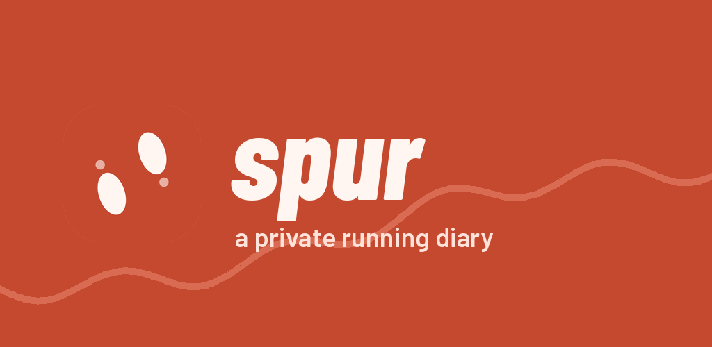
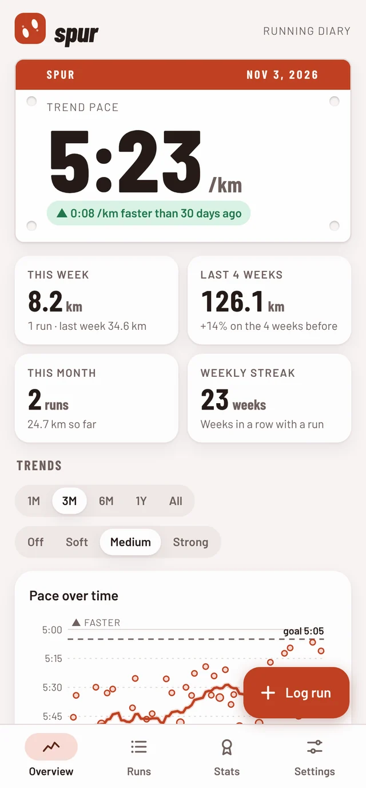
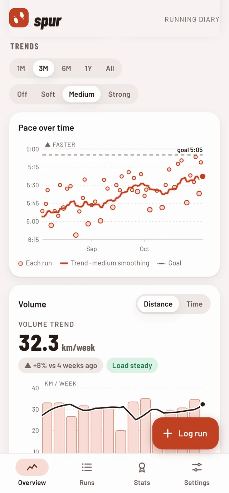
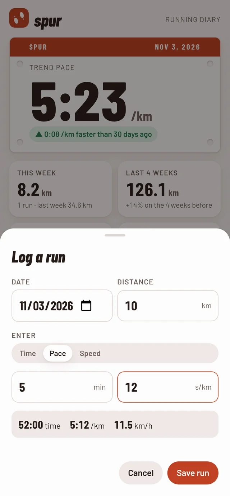
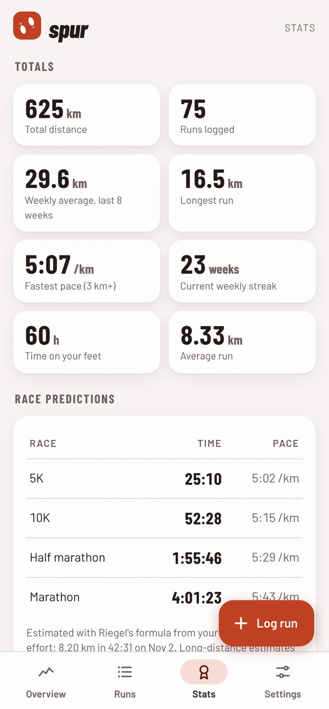
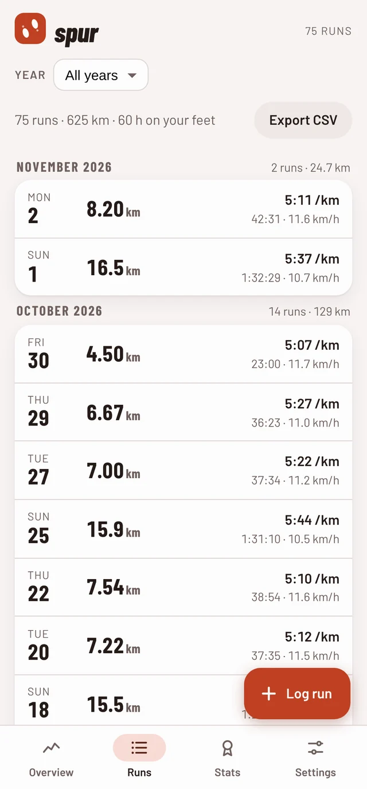

<p align="center">
  
</p>

<p align="center">
  <a href="LICENSE"></a>
  <a href="https://github.com/dabane-ghassan/spur/releases/latest"></a>
  <a href="https://github.com/dabane-ghassan/spur/actions/workflows/android.yml"></a>
  <a href="https://buymeacoffee.com/ghassandabane"></a>
</p>

# A simple running diary that respects your privacy.

Log the distance and time after each run. spur smooths out the good days and the bad days and shows whether you are really getting faster.

*spur* is German for *track*: a diary of the tracks you leave.

## Installation

<p>
  <a href="https://github.com/dabane-ghassan/spur/releases/latest"></a>
  
  <a href="selfhost/README.md"></a>
</p>

Android 7.0 or newer. Prefer the browser? Run the [self-hosted web app](selfhost/README.md) on your own server. More on the [website](https://dabane-ghassan.github.io/spur/).

## Why spur?

- **Truly free**: no ads, no account, no trackers
- **Pace and volume trends** with smoothing you choose: off, soft, medium or strong
- **Pace goal** with a forecast date, and a warning when your weekly distance jumps too fast
- **Race predictions** from 5K to the marathon, and milestones along the way
- **Your data, your files**: export and import plain CSV files, shared with the web app
- **Privacy**: no permissions, no internet access; your runs never leave your phone
- **Copylefted libre software** under the GNU GPL v3 or later

## Screenshots

<p align="center">
  
  
  
  
  
</p>

## Self-hosting

```sh
git clone https://github.com/dabane-ghassan/spur
cd spur/selfhost
docker compose up -d        # then open http://your-server:4219
```

Accounts, HTTPS with Caddy, backups and the full API are described in [selfhost/README.md](selfhost/README.md).

## Building

The APK is built by [GitHub Actions](.github/workflows/android.yml) on every push. To build it yourself, or to sign and release it, see [BUILDING.md](BUILDING.md).

## FAQ

**Will spur stay free?** Yes, with every feature, always.

**Does it track my runs with GPS?** No, on purpose. You type in the distance and time from your watch or a map, so there is no location data to leak.

**Could you add feature X?** Open an [issue](https://github.com/dabane-ghassan/spur/issues) or a pull request.

## Support

If spur helps your running, you can [buy me a coffee](https://buymeacoffee.com/ghassandabane) ☕

## License

spur is licensed under the [GNU GPL v3 or later](LICENSE). The Barlow fonts are under the SIL Open Font License 1.1.
